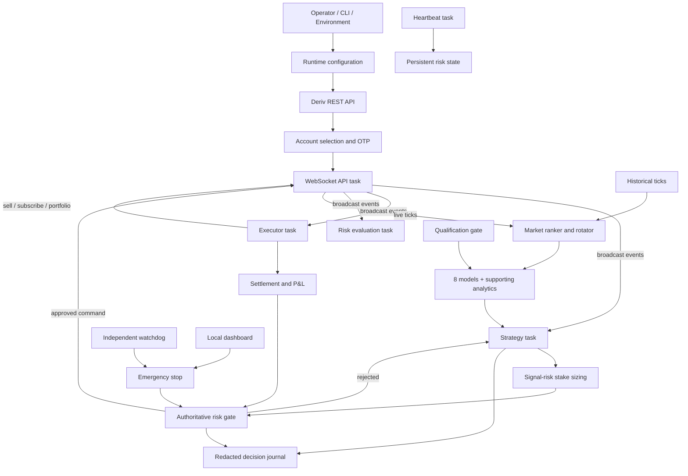

# Deriv Multi-Strategy Trading Platform — Source-Code Acquisition

> **A complete, inspectable Rust trading platform—not a black-box script.**
>
> Research the market. Test deterministically. Execute with guardrails. Audit every decision.

This acquisition offers a substantial engineering head start for a buyer building on the Deriv ecosystem. The repository combines more than 9,000 physical lines of Rust and supporting automation code across broker connectivity, multi-market analysis, eight strategy-model slots, four contract families, deterministic simulation, guarded execution, operational recovery, fixed-point risk controls, a local dashboard, an independent watchdog, automated tests, and a structured buyer data room.

The product is positioned for a technical buyer, trading-automation team, software operator, or acquirer that values source ownership and auditability. It can be independently evaluated, extended, integrated, branded, and operated under the rights granted in the final signed agreement. The platform scans configured synthetic indices, consumes operator-supplied history, evaluates multiple contract paths, records why actions were accepted or rejected, and places an authoritative risk gate between every signal and the broker.

This is more than an entry algorithm. It includes the operational foundation needed to evaluate and run an automated system responsibly: safe-by-default demo operation, reproducible historical simulation, an explicitly gated live build, reconnect recovery, uncertain-buy reconciliation, persistent circuit breakers, an emergency-stop dashboard, an independent watchdog, and structured audit records.

> [!WARNING]
> This software is experimental and is supplied as software infrastructure, not as a promise of income. Trading can cause partial or total loss of capital. No profit, win rate, future result, uninterrupted operation, or protection from loss is guaranteed. Demo mode is the default. Real-money use requires the buyer's own informed decision, credentials, configuration, supervision, validation, and independent legal, security, quantitative, regulatory, and operational review.

## Buyer overview

The acquisition value is in a substantial, documented engineering base that a buyer can inspect before relying on it:

| Delivered area | Buyer value |
|---|---|
| Rust/Tokio trading runtime | A compiled asynchronous foundation instead of an opaque indicator or browser script |
| Deriv integration | REST account discovery and OTP-authenticated Options WebSocket workflow |
| Multi-market intelligence | Historical loading, live buffers, ranking, rotation, staleness checks, and ten configured synthetic indices |
| Eight model slots | Separately gated research signals with fail-closed qualification rather than automatic production claims |
| Four contract families | Accumulator, Over/Under, Matches/Differs, and Rise/Fall command and settlement paths |
| Authoritative risk layer | Fixed-point stakes, exposure ceilings, one-open-contract enforcement, cooldowns, and persistent stops |
| Resilient execution | Proposal/buy/sell lifecycle, reconnect handling, uncertain-buy reconciliation, and sell retry behavior |
| Deterministic evaluation | Seeded replay, virtual time, replay hashes, fault injection, and detailed hypothetical metrics |
| Operational controls | Authenticated local dashboard, CSRF protection, action audit, heartbeat, and independent watchdog |
| Due-diligence package | Architecture, capability matrix, SBOM, third-party notices, security evidence, onboarding, and legal drafts |

The code is deliberately transparent about what has and has not been proven. A buyer can reproduce engineering checks, inspect every risk gate, and qualify strategies with their own lawfully obtained datasets instead of relying on undocumented marketing claims.

### Acquisition highlights

- **Immediate engineering leverage:** acquire a working, modular platform rather than funding a broker adapter, simulator, execution state machine, risk layer, dashboard, watchdog, and evidence package from zero.
- **Inspectable before reliance:** core behavior is in readable Rust source with automated tests, explicit configuration, deterministic replay, and decision journals.
- **Commercially adaptable:** suitable for further productization, branding, integration, strategy research, or internal deployment, subject to the final agreement and applicable third-party terms.
- **Built-in operational safeguards:** real-money execution requires both a compile-time feature and an exact runtime acknowledgement.
- **Structured handover:** onboarding, architecture, capability mapping, security evidence, data provenance, SBOM material, third-party notices, legal drafts, and evaluation automation are organized in the repository.
- **Evidence available for controlled review:** the seller reports six months of demo-account testing and prior live-account use. Supporting broker records should be reviewed through a controlled, appropriately redacted due-diligence process. This is seller-reported history—not an independently verified duration, performance claim, or promise of future results.

### Ideal buyer

This asset is best suited to a buyer seeking:

- A Rust foundation for Deriv automation and quantitative experimentation.
- A multi-strategy platform that can be extended without replacing the broker, execution, risk, and observability layers.
- Reproducible evaluation and a documented path from simulation to demo operation.
- A proprietary product base that can be branded or integrated after technical and legal due diligence.
- A transparent alternative to an opaque executable, signal subscription, or single-strategy script.

## Verified engineering snapshot

At the current workspace revision:

- **Seller-reported operating history:** six months of Deriv demo-account testing and prior live-account use. The repository does not independently prove elapsed duration, profitability, win rate, return, or production readiness.
- **Reproducible demo evidence:** authenticated dashboard start/stop, demo-account selection, OTP WebSocket connection, proposal, buy, contract monitoring, settlement, P&L journalling, and emergency-stop behavior have been exercised end to end.
- **Reproducible live-path evidence:** the live feature compiles and its account-selection, acknowledgement, risk-configuration, authorization, and fail-closed control paths are verified. A real-money trade was intentionally not submitted during the latest deployment verification; historical live evidence is a separate due-diligence item.
- All maintained executable implementation is Rust, including runtime, supervision, release operations, history auditing, and in-source tests.
- HTML and CSS remain presentation templates; JSON, Markdown, YAML, and TOML remain interoperable data, documentation, and configuration formats.
- Trading/research core: 2,589 lines across models, strategy, qualification, mathematics, risk engines, and backtesting.
- Automated test result: 103 passed, 0 failed, 0 ignored across the maintained Rust targets (verified 2026-08-13).
- `cargo check --all-targets`, formatting validation, and strict Clippy with warnings denied pass locally.

Line counts describe implementation scope, not software quality, profitability, or market value. The reproducible checks and disclosed limitations are the more important buyer evidence.

## What a source-code transaction can include

Subject to the final signed agreement and delivery schedule, a transaction can include the original Rust source, dashboard and watchdog source, configuration templates, tests, Docker files, documentation, SBOM, third-party notices, and a defined handover/support period.

Buyer-owned Deriv accounts, credentials, application registrations, balances, API entitlements, and third-party data rights are not created or transferred by delivery of this repository. Historical datasets are included only when they are explicitly listed in the signed delivery schedule and their transfer rights have been independently verified and documented.

### Controlled buyer evaluation

A serious buyer can evaluate the asset through a staged process that protects both parties:

1. Review this README, the capability matrix, architecture, claims register, security evidence, and roadmap.
2. Run the included buyer evaluation and reproducible engineering checks in an isolated environment.
3. Inspect relevant source, tests, configuration boundaries, and deterministic reports.
4. Review seller-held live proof through an agreed, redacted process that preserves verifiable trade context while excluding credentials and unnecessary personal or account data.
5. Agree the exact asset schedule, intellectual-property rights, excluded third-party items, acceptance criteria, handover, and support terms in a signed contract.

The repository is designed to support diligence with reproducible evidence instead of relying on screenshots or unsupported claims.

## Contents

- [Capabilities](#capabilities)
- [Buyer overview](#buyer-overview)
- [Acquisition highlights](#acquisition-highlights)
- [Ideal buyer](#ideal-buyer)
- [Verified engineering snapshot](#verified-engineering-snapshot)
- [What a source-code transaction can include](#what-a-source-code-transaction-can-include)
- [Controlled buyer evaluation](#controlled-buyer-evaluation)
- [Why this bot exists](#why-this-bot-exists)
- [What makes it different](#what-makes-it-different)
- [Architecture](#architecture)
- [Trading models](#trading-models)
- [Contract families](#contract-families)
- [Risk management](#risk-management)
- [Requirements](#requirements)
- [Quick start](#quick-start)
- [Configuration](#configuration)
- [Runtime modes](#runtime-modes)
- [CLI options](#cli-options)
- [Dashboard and watchdog](#dashboard-and-watchdog)
- [Emergency stop](#emergency-stop)
- [Simulation and backtesting](#simulation-and-backtesting)
- [Testing](#testing)
- [Project structure](#project-structure)
- [Security](#security)
- [Data and audit records](#data-and-audit-records)
- [Known limitations](#known-limitations)
- [Intellectual property](#intellectual-property)
- [Disclaimer](#disclaimer)

## Why this bot exists

Markets move quickly. Good trading software should therefore do three things consistently: understand the available evidence, refuse unsafe trades, and explain what it did. This bot is designed around those principles. It can learn from the operator-owned Deriv history dataset, continue collecting new ticks during long-running operation, compare configured markets, and keep its decisions reproducible for later review.

The result is a transparent foundation for an operator who wants automation without surrendering visibility or control. Demo mode is the default, simulation is deterministic, and live trading requires an explicit acknowledgement gate.

## What makes it different

| Area | What the platform delivers |
|---|---|
| Market intelligence | Continuous multi-market scanning, historical ranking, live tick buffers, and eight separately qualified model slots |
| Contract coverage | Accumulator, Over/Under, Matches/Differs, and Rise/Fall command and settlement paths |
| Safety | Fixed-point money calculations, one-open-contract enforcement, exposure ceilings, cooldowns, and persistent stops |
| Reproducibility | Seeded simulation, virtual time, replay hashes, fault injection, and auditable backtest metrics |
| Resilience | Reconnect handling, stale-data checks, uncertain-buy portfolio reconciliation, and sell retry logic |
| Operator control | Local dashboard, authenticated emergency stop, independent watchdog, heartbeat, and durable risk state |
| Explainability | Redacted JSONL journal covering decisions, transitions, execution metadata, recovery, latency, and P&L |

Every row describes an implemented code path, not a promise of profitability. Model qualification and live readiness are deliberately treated as evidence gates rather than marketing labels.

## Capabilities

- Rust/Tokio asynchronous runtime.
- Deriv REST account discovery and OTP-authenticated Options WebSocket flow.
- Demo, deterministic simulation, and separately gated live modes.
- Eight mathematical signal models with fail-closed qualification.
- ACCU, Over/Under, Matches/Differs, and Rise/Fall command paths.
- Historical market loading, live tick buffers, market ranking, and market rotation.
- Continuous persistence of received ticks into the configured local history directory.
- Analyse-only signal observation during risk, timing, or pacing cooldowns without dispatching a trade.
- Signal-risk and balance-derived stake sizing using fixed-point minor units.
- One-open-contract invariant, exposure ceilings, loss cooldowns, and persistent circuit breakers.
- Proposal, buy, open-contract, sell, and settlement state machine.
- Reconnect handling and uncertain-buy portfolio reconciliation.
- Redacted append-only decision journal and 24-hour raw/API-record retention.
- Expiring, rate-limited dashboard authentication with CSRF protection and retained operator-action audit records.
- Independent watchdog and local operator dashboard.
- Deterministic replay, fault injection, backtest metrics, and reliability tests.

## Architecture



### Trade lifecycle

```text
Idle
  -> CollectingTicks
  -> Analysing
  -> ProposalPending
  -> ProposalReady
  -> BuyPending
  -> ContractOpen
  -> Settling
  -> CooldownOrReanalyse
  -> CollectingTicks
```

Invalid transitions are rejected and journalled. A disconnect during an uncertain buy triggers portfolio reconciliation instead of blindly submitting another buy.

## Trading models

The core consensus contains eight model slots:

1. Fluid Dynamics
2. Chaos Theory
3. Mean Reversion
4. Trend Analysis
5. Multi-Timeframe Analysis
6. Nash Equilibrium
7. Tick Velocity
8. Volume Surge

Supporting analytics include Kalman-derived values, Hurst analysis, match-risk prediction, market-quality ranking, directional validation, Wilson confidence bounds, and consensus/confidence gates.

Model presence is not the same as model qualification. A model receives production consensus weight only when its evidence entry passes every requirement in `config/strategy-qualifications.json`. The default registry may leave models unqualified and therefore excluded.

## Contract families

| Family | Purpose | Important gate |
|---|---|---|
| Accumulator | Short-lived accumulation entry | Proposal edge and exit monitoring |
| Over/Under | Digit barrier contract | Consensus and match-risk checks |
| Matches/Differs | Digit prediction contract | Calibrated match-risk threshold |
| Rise/Fall | Directional contract | Historical directional validation and confidence bounds |

Support for a contract command path does not establish that the contract is profitable or suitable for live trading.

## Risk management

The dashboard accepts an operator-selected maximum stake from **$1.00 to $100.00** for demo and guarded live sessions. This is an absolute ceiling, not a guaranteed trade size: verified-balance sizing, open-exposure budgets, signal-risk scaling, drawdown logic, contract availability, and broker proposal limits may reduce or reject it.

The current local `.env.example` remains a stricter $50-bankroll example profile:

| Control | Setting |
|---|---:|
| Signal-scaled stake | $1.00-$3.00 |
| Example profile maximum | $3.00 |
| Product absolute ceiling | $100.00 |
| Maximum session loss on $50 | $5.00 |
| Maximum open exposure | 6% |
| Maximum open contracts | 1 |
| Consecutive-loss stop | 3 |
| Base loss cooldown | 60 seconds |
| Martingale | Not used |

Stake is scaled between the provider minimum and the session cap according to signal risk. After a loss, the risk manager reduces the next stake to the minimum. Repeated losses increase the cooldown and eventually engage a persistent stop.

The pre-trade gate also checks:

- Verified balance and fixed-point monetary precision.
- Hard stake ceiling.
- Market/family/open-exposure budgets.
- Confirmed proposal identity, price, and age.
- One-open-contract cardinality.
- Stale WebSocket data and API error-rate kill switches.
- Manual and previously persisted stops.

The Docker Compose file may intentionally override these values with a stricter minimum-stake evaluation profile. Review the effective environment before every run.

## Requirements

- Rust stable toolchain with Cargo.
- A buyer/operator-owned Deriv application ID.
- A buyer/operator-owned OAuth access token or PAT.
- A Deriv Options demo account for demo operation.
- A local historical CSV directory for simulation and market-history features.
- Linux is recommended for watchdog and container hardening behavior.

## Quick start

1. Clone or unpack the repository.
2. Create a private local environment file:

```bash
cp .env.example .env
```

3. Edit `.env` and provide your own credentials:

```dotenv
DERIV_APP_ID=your_application_id
DERIV_ACCESS_TOKEN=your_access_token
DERIV_MODE=demo
HISTORY_PATH=/absolute/path/to/licensed/history
```

4. Build and test:

```bash
cargo build
cargo test
```

5. Run demo mode:

```bash
cargo run -- --mode demo --history /absolute/path/to/licensed/history
```

Never use seller credentials, commit `.env`, or place credentials in command-line arguments, logs, screenshots, support messages, or buyer packages.

## Configuration

### Broker and runtime

| Variable | Description |
|---|---|
| `DERIV_APP_ID` | Operator-owned Deriv application ID |
| `DERIV_ACCESS_TOKEN` | Preferred OAuth/PAT bearer token |
| `DERIV_PAT` | Legacy fallback token name |
| `DERIV_PAT_TOKEN` | Older legacy fallback; migrate to `DERIV_ACCESS_TOKEN` |
| `DERIV_MODE` | `demo`, `simulation`, or `live` |
| `DERIV_SYMBOLS` | Comma-separated symbols |
| `HISTORY_PATH` | Historical CSV directory |
| `DEMO_DURATION_SECS` | `0`/unset for continuous demo; positive value for a deadline |
| `DERIV_RANDOM_SEED` | Deterministic simulation seed |
| `DERIV_RISE_FALL_DURATION_MINUTES` | Rise/Fall duration, clamped to 1-60 minutes |
| `DERIV_ENABLE_LIVE_TRADING` | Exact live-mode acknowledgement; compile-time feature is also required |
| `RUST_LOG` | Rust log filter, normally `info` |

Default configured symbols:

```text
R_10, 1HZ10V, R_25, 1HZ25V, R_50,
1HZ50V, R_75, 1HZ75V, R_100, 1HZ100V
```

### Risk configuration

All monetary values ending in `_MINOR` use currency minor units. For USD, `300` means `$3.00`.

| Variable | Description |
|---|---|
| `DERIV_MAX_STAKE_MINOR` | Absolute per-trade stake ceiling |
| `DERIV_SESSION_LOSS_LIMIT_BPS` | Session loss limit in basis points |
| `DERIV_MAX_OPEN_EXPOSURE_BPS` | Maximum total open exposure in basis points |
| `DERIV_MAX_OPEN_CONTRACTS` | Must be exactly `1` |
| `DERIV_MAX_CONSECUTIVE_LOSSES` | Persistent stop threshold, accepted range 1-10 |
| `DERIV_LOSS_COOLDOWN_BASE_SECS` | Base post-loss cooldown, accepted range 10-3600 |

One basis point is 0.01%; therefore 600 basis points is 6%.

### Storage and operations

| Variable | Description |
|---|---|
| `DERIV_RISK_STATE_DIR` | Persistent stop, heartbeat, and runtime-lock directory |
| `DERIV_API_RECORDS_DIR` | Raw/ephemeral API-derived record directory |
| `DERIV_AUDIT_JOURNAL_DIR` | Normalized metadata audit directory |
| `DERIV_DASHBOARD_BIND` | Dashboard bind address; defaults to loopback |
| `DERIV_DASHBOARD_TOKEN` | Temporary 32+ character operator token |
| `DERIV_DASHBOARD_CSRF_TOKEN` | Separate temporary 32+ character CSRF token |
| `DERIV_DASHBOARD_TOKEN_EXPIRES_UNIX` | Token expiry as Unix time |
| `DERIV_DASHBOARD_AUDIT_RETENTION_SECS` | Dashboard action-audit retention; defaults to 7 days |
| `DERIV_WATCHDOG_STALE_SECS` | Heartbeat staleness threshold |
| `DERIV_WATCHDOG_STARTUP_GRACE_SECS` | Watchdog startup grace period |

### Qualification and verification

| Variable | Description |
|---|---|
| `STRATEGY_QUALIFICATIONS_PATH` | Optional path to the model-evidence registry; defaults to `config/strategy-qualifications.json` |
| `SIM_EXPECT_REPLAY_HASH` | Optional expected simulation replay hash; the run fails when reproducibility differs |
| `HISTORY_TEST_PATH` | Optional external history path used by the ignored dataset-dependent test |

## Runtime modes

### Demo

Connects to a Deriv demo/virtual Options account:

```bash
cargo run -- --mode demo --history /path/to/history
```

Demo mode can still lose virtual funds and does not prove live profitability.

### Simulation

Runs deterministic historical replay without connecting to the broker:

```bash
DERIV_RANDOM_SEED=42 cargo run -- --mode simulation --history /path/to/history
```

Simulation reports are hypothetical and include approximate contract pricing. See `BACKTESTING.md`.

### Live

Live mode is protected by two independent gates:

1. Compile with the `live-trading` feature.
2. Supply the exact runtime acknowledgement.

```bash
DERIV_ENABLE_LIVE_TRADING=I_UNDERSTAND_REAL_MONEY \
  cargo run --release --features live-trading -- \
  --mode live --history /path/to/history
```

> [!CAUTION]
> The presence of a live code path is not evidence of production readiness, regulatory compliance, safety, or profitability. Do not use real money without independent professional review and controlled validation.

## CLI options

Both spaced and `=` forms are supported:

```text
--mode demo
--mode=simulation
--symbols R_10,R_50
--symbols=R_10,R_50
--symbol R_100
--history /path/to/history
--history=/path/to/history
```

CLI values override the corresponding environment defaults.

## Dashboard and watchdog

Build the operational binaries:

```bash
cargo build --release --bin deriv_platform --bin deriv_watchdog
```

Run the dashboard on loopback only unless it is placed behind an appropriately configured TLS reverse proxy:

```bash
cargo run --release --bin deriv_platform
```

Run the independent watchdog:

```bash
cargo run --release --bin deriv_watchdog
```

The dashboard provides real-time telemetry, persisted $1-$100 stake selection, session-loss configuration, authenticated demo start, guarded live start, graceful stop, and persistent emergency stop. Live start requires saved risk limits, explicit real-money acknowledgement, typed `LIVE` confirmation, an idle engine, and final confirmation. Stake bounds, one-open-contract cardinality, operator authorization, CSRF protection, token expiry, auditing, and persistent stops are enforced server-side.

The browser never receives broker credentials. Behind the supplied authenticated TLS proxy, operator and CSRF credentials are injected server-side and must not be committed or exposed as buyer-facing secrets. During ownership transfer the buyer should provision its own domain/IP, TLS, dashboard login, operator/CSRF secrets, Deriv credentials, and cloud account.

Docker deployment:

```bash
docker compose up --build
```

Before starting Compose, configure long, separate, temporary dashboard and CSRF tokens plus a future expiry. Compose uses persistent risk/audit volumes and hardened container settings.

## Emergency stop

To stop new entries manually, create the stop file in the configured risk-state directory:

```bash
touch .risk/emergency.stop
```

The dashboard can create the same persistent stop through its authenticated API. A stop does not authorize abandoning an already open contract; reduce-only monitoring and valid tracked sells remain permitted.

Persistent stops require operator review. Do not casually delete stop files or state until the cause, open exposure, provider portfolio, and audit trail have been reconciled.

## Simulation and backtesting

Basic deterministic run:

```bash
DERIV_RANDOM_SEED=42 \
  cargo run -- --mode simulation --history /path/to/csv-directory
```

Replay-hash verification:

```bash
SIM_EXPECT_REPLAY_HASH=expected_hash \
DERIV_RANDOM_SEED=42 \
  cargo run -- --mode simulation --history /path/to/csv-directory
```

Metrics include trade count, P&L, drawdown, confidence intervals, profit factor, risk of ruin, average/median/tail loss, and worst consecutive-loss run. These values are hypothetical and depend on input quality and pricing assumptions.

During connected operation, accepted live ticks are also appended to symbol-specific CSV files beneath `HISTORY_PATH`. Keep that directory writable for direct runs; the supplied Compose evaluation profile mounts normalized history read-only and is intended for controlled preflight use.

## Testing

Run the complete suite:

```bash
cargo test
```

Additional checks:

```bash
cargo fmt -- --check
cargo check --all-targets
cargo test --release
```

An external-history test is ignored when the operator-held dataset is unavailable in the test environment. Synthetic fixtures test mechanics; they do not demonstrate market performance.

Current verified local result: **103 tests passed, 0 failed, 0 ignored** across all seven Rust binaries. Test totals can change as the product evolves; regenerate and preserve a dated test report for the final buyer delivery.
### Evidence classification

| Statement | Classification |
|---|---|
| 98-test result and live-feature build | Reproducible in the repository |
| Current dashboard/API HTTPS checks | Deployment verification; repeat during buyer acceptance |
| End-to-end demo proposal/buy/settlement exercise | Current deployment evidence and redacted logs |
| Six months of demo testing | Seller-reported; broker records required for independent verification |
| Historical live-account use | Seller-reported; review redacted broker evidence separately |
| Profitability, future return, or production readiness | Not claimed |

## Project structure

```text
src/main.rs                         Runtime orchestration and async tasks
src/modules/api.rs                  REST/WebSocket commands, events, parsing
src/modules/models.rs               Domain models, predictor, state machine
src/modules/strategy.rs             Eight mathematical strategies and gates
src/modules/market.rs               History loader, ranker, market rotation
src/modules/risk.rs                 Stake sizing, P&L, circuit breakers
src/modules/risk_v2.rs              Authoritative risk and persistent safety
src/modules/execution.rs            Execution pacing and helpers
src/modules/qualification.rs        Fail-closed model evidence gate
src/modules/backtest.rs             Deterministic replay and metrics
src/modules/deterministic.rs        Virtual clock and seeded behavior
src/modules/journal.rs              Redacted decision journal
src/modules/runtime.rs              CLI, credentials, runtime risk config
src/modules/interfaces.rs           Broker boundary
src/modules/retention.rs            API-record retention
src/bin/platform.rs                 Local dashboard/API
src/bin/watchdog.rs                 Independent heartbeat watchdog
config/strategy-qualifications.json Model evidence registry
schemas/deriv/pinned-contracts.json Pinned wire-contract schema
web/                                Dashboard frontend
data-room/                           Buyer evidence and architecture package
```

The implementation currently uses `include!` from `main.rs` while the shared `src/modules.rs` boundary is being migrated incrementally.

## Security

- Never commit `.env`, access tokens, OTP URLs, account IDs, or raw portfolio data.
- Use credentials owned by the operator/buyer and grant only required scopes.
- Rotate any credential that appears in a repository, shell history, log, screenshot, or delivery archive.
- Keep the dashboard on loopback or behind TLS and network access controls.
- Use distinct dashboard bearer and CSRF tokens with short expiries.
- Preserve the persistent risk-state volume across restarts.
- Treat logs and audit records as sensitive even when identifiers are normalized.
- Run dependency, secret, legal, and security reviews before release.

## Data and audit records

- Deriv support reportedly confirmed on 2026-08-06 that the supplied historical data may be retained long term without a separate licence; preserve the original confirmation as evidence.
- Long-term retention permission does not by itself grant redistribution or buyer-transfer rights.
- No Deriv API entitlement, account, credential, dataset, or rate-limit allocation transfers with this source code.
- Raw/ephemeral API-derived records are disabled by default and, when present in the configured record directory, are purged after 24 hours.
- The normalized decision journal is stored separately from raw/API records and captures configuration, dataset/seed context, decisions, state transitions, order lifecycle metadata, recovery actions, latency, and P&L calculations.
- Dashboard operator actions use a separate audit log with configurable retention (seven days by default).
- Never include historical datasets in a buyer package without separate redistribution/transfer permission, or include seller credentials under any circumstances.

## Known limitations

- **Tradier is not implemented.** This repository contains only the Deriv broker adapter; there is no Tradier authentication, market-data, order-routing, account, or settlement integration. Adding Tradier requires a separately designed and tested adapter.

- No verified profitability or guaranteed win rate.
- No independently established live performance.
- Backtest contract pricing is approximate.
- No historical market dataset is bundled with source or buyer packages; operator-held history is loaded through `HISTORY_PATH`.
- Default model qualification may exclude all eight models until valid evidence is supplied.
- Only one production broker adapter is implemented.
- Provider APIs, terms, instruments, and rate limits can change.
- Live mode has not been established as production-ready or regulator-approved.
- Independent security, quantitative, legal, and real-money risk reviews remain required.
- A signed release, external audit, and documented long-duration soak are not currently established.

See `CLAIMS.md`, `SECURITY_EVIDENCE.md`, `BACKTESTING.md`, and `data-room/CAPABILITIES.md` before making any product or performance claim.

## Intellectual property

Copyright (c) 2026. All rights reserved. This repository is proprietary unless a signed agreement expressly grants specific rights.

Third-party Rust crates, Deriv services and trademarks, provider data, and external datasets remain subject to their respective owners and terms. Possession of this repository does not transfer provider access, credentials, data rights, or permission to redistribute third-party material.

Any commercial licence or copyright assignment must be set out in a separate signed agreement. The files under `legal/drafts/` are unsigned drafts and require qualified legal review before use.

## Disclaimer

This project is software and research infrastructure, not financial, investment, legal, tax, or regulatory advice. It does not manage the buyer's account or make a personal recommendation that trading is suitable for the buyer.

Trading is speculative and can result in partial or total loss of the money committed. The buyer/operator is solely responsible for deciding whether to trade, understanding the relevant instruments and provider terms, selecting and safeguarding credentials, choosing lawful datasets, reviewing configuration, setting acceptable exposure, monitoring open positions, maintaining connectivity and infrastructure, and deciding whether and when to enable real-money execution.

Backtests, simulations, mathematical models, confidence measures, code coverage, passing tests, demo results, and historical observations do not guarantee live or future performance. Actual execution can differ because of market behavior, pricing, latency, slippage, liquidity, outages, API changes, rejected requests, configuration, data quality, software defects, or other known and unknown conditions.

To the maximum extent permitted by the governing law and the final signed agreement, the software is supplied **as is** and **as available**, without a guarantee of profit, win rate, availability, accuracy, security, fitness for a particular purpose, uninterrupted operation, or any trading outcome. The seller, authors, and contributors do not accept responsibility for trading decisions or losses merely because this software was evaluated, licensed, modified, deployed, or used.

No README disclaimer can by itself determine or eliminate legal liability. The final transaction must use a signed agreement reviewed for the parties' jurisdiction, with negotiated acceptance criteria, permitted use, warranties, liability limits, indemnities, data/API obligations, support scope, and dispute terms. The buyer should test in simulation and demo mode and obtain independent professional advice before considering real-money use.

## Canonical current implementation reference

This section is authoritative for the current Rust-only executable implementation. If an older narrative example conflicts with this section, use this section and `.env.example`.

### Executable inventory

| Binary | Purpose | Network access |
|---|---|---|
| `deriv_bot` | Simulation, demo, or feature-gated live trading runtime | Simulation: none; demo/live: Deriv REST and WebSocket |
| `deriv_supervisor` | Consumes dashboard control files and owns at most one `deriv_bot` child | Indirectly through its child |
| `deriv_platform` | JavaScript-free server-rendered dashboard and JSON control API | Local HTTP only |
| `deriv_watchdog` | Checks heartbeat/process identity and latches safety state when stale | None |
| `deriv_history` | Audits/normalizes licensed CSV history and calculates synchronized coverage | None |
| `deriv_ops` | Release readiness, reproducible build, buyer evaluation, and guarded packaging | Cargo/Docker commands may use their normal registries |
| `generate_synthetic_fixture` | Recreates the deterministic synthetic test fixture | None |

All maintained executable implementation is Rust. HTML/CSS remain browser presentation templates; JSON, CSV, Markdown, YAML, and TOML remain interoperable evidence, data, documentation, and configuration formats.

### Complete CLI reference

```text
deriv_bot [--mode demo|live|simulation]
          [--symbols SYMBOL[,SYMBOL...]]
          [--symbol SYMBOL]
          --history PATH

deriv_watchdog [--check]
deriv_supervisor
deriv_platform
generate_synthetic_fixture [OUTPUT_DIRECTORY]
deriv_ops release-readiness|reproducible-build|buyer-evaluate|package-data-room
deriv_history audit --raw DIR --normalized DIR --report FILE --manifest FILE
deriv_history overlap --normalized DIR --audit FILE --manifest FILE --markdown FILE
```

CLI mode/symbol/history values override their environment equivalents. `--symbols=` and `--history=` forms are accepted. Unknown `deriv_bot` arguments fail startup. Network modes require explicit history and all six risk variables. Simulation uses reviewed compiled risk defaults.

### Complete environment reference

| Variable | Required/default | Meaning |
|---|---|---|
| `DERIV_MODE` | default `demo` | `simulation`, `demo`, or `live` |
| `DERIV_SYMBOLS` | ten compiled markets | Comma-separated symbol allow-list |
| `HISTORY_PATH` | required by runtime | Licensed CSV file/directory used for warm-up/replay |
| `DERIV_APP_ID` | demo/live | Buyer-owned Deriv application ID |
| `DERIV_ACCESS_TOKEN` | demo/live | Preferred buyer-owned bearer token |
| `DERIV_PAT`, `DERIV_PAT_TOKEN` | compatibility only | Legacy token fallbacks; migrate to `DERIV_ACCESS_TOKEN` |
| `DERIV_RANDOM_SEED` | fixed default | Deterministic decision/replay seed |
| `DEMO_DURATION_SECS` | unset/`0` = continuous | Optional demo deadline |
| `DERIV_RISE_FALL_DURATION_MINUTES` | reviewed 1–60 | Rise/Fall expiry |
| `DERIV_ADVANCED_FAMILIES_ACTIVATION_DELAY_SECS` | default 10,800 | Delay before advanced contract families; legacy alias: `DERIV_RISE_FALL_ACTIVATION_DELAY_SECS` |
| `DERIV_ENABLE_LIVE_TRADING` | live only | Must exactly equal `I_UNDERSTAND_REAL_MONEY`; Cargo feature is also required |
| `DERIV_MAX_STAKE_MINOR` | explicit demo/live | 100–10,000 minor units in reviewed USD deployment |
| `DERIV_SESSION_LOSS_LIMIT_BPS` | explicit demo/live | 1–2,000 basis points |
| `DERIV_MAX_OPEN_EXPOSURE_BPS` | explicit demo/live | 1–1,000 basis points |
| `DERIV_MAX_OPEN_CONTRACTS` | explicit demo/live | Must equal `1` |
| `DERIV_MAX_CONSECUTIVE_LOSSES` | explicit demo/live | 1–10; threshold latches a persistent stop |
| `DERIV_LOSS_COOLDOWN_BASE_SECS` | explicit demo/live | 10–3,600 seconds; exponential cooldown capped at one hour |
| `DERIV_RISK_STATE_DIR` | default `.risk` | Shared durable heartbeat, lock, exposure, stop, and control state |
| `DERIV_AUDIT_JOURNAL_DIR` | default `data/audit` | Redacted append-only decision journal |
| `DERIV_API_RECORDS_DIR` | default `data/api-records` | Ephemeral raw API records; 24-hour retention policy |
| `STRATEGY_QUALIFICATIONS_PATH` | default `config/strategy-qualifications.json` | Fail-closed model evidence registry |
| `DERIV_DASHBOARD_BIND` | default `127.0.0.1:8080` | Dashboard listen address |
| `DERIV_DASHBOARD_TOKEN` | write controls | 32+ character temporary operator bearer token |
| `DERIV_DASHBOARD_CSRF_TOKEN` | write controls | Separate 32+ character CSRF secret |
| `DERIV_DASHBOARD_TOKEN_EXPIRES_UNIX` | write controls | Future Unix expiry; expired credentials fail closed |
| `DERIV_DASHBOARD_AUDIT_RETENTION_SECS` | default 604,800 | Dashboard action-audit retention, clamped to 1–30 days |
| `DERIV_WATCHDOG_STALE_SECS` | default 15 | Heartbeat staleness threshold |
| `DERIV_WATCHDOG_STARTUP_GRACE_SECS` | default 30 | Grace before watchdog enforcement |
| `HISTORY_PATH` | supervisor default `/history/normalized` | Child runtime history path |
| `FINAL_BUYER_LICENCE` | packaging only | Lawyer-reviewed licence path |
| `FINAL_BUYER_LICENCE_REVIEWED` | packaging only | Must equal `YES` |
| `RUST_LOG` | optional | Rust log filter |

Simulation fault/evaluation knobs are `SIM_PROPOSAL_TTL_MS`, `SIM_LATENCY_MS`, `SIM_STALE_QUOTE_MS`, `SIM_PAYOUT_BPS`, `SIM_FEE_BPS`, `SIM_SLIPPAGE_BPS`, `SIM_RATE_LIMIT_PER_SEC`, `SIM_DISCONNECT_PPM`, `SIM_REJECT_PPM`, `SIM_LOST_BUY_RESPONSE_PPM`, `SIM_SELL_FAILURE_PPM`, `SIM_MISSING_TICK_PPM`, `SIM_OUT_OF_ORDER_PPM`, `SIM_MAX_SELL_RETRIES`, `SIM_ACCU_GROWTH_BPS`, `SIM_CONTRACT_DURATION_TICKS`, `SIM_SELL_BID_DISCOUNT_BPS`, and optional replay assertion `SIM_EXPECT_REPLAY_HASH`.

### Dashboard and control contract

The dashboard HTML is rendered by `deriv_platform` from the risk directory and decision journal. It uses a five-second HTML refresh and no JavaScript. Read routes are unauthenticated at the Rust server boundary and must be protected by the deployment boundary when remotely exposed. Every write requires bearer, separate CSRF, operator role, and unexpired credentials.

| Method/path | Result and required control headers |
|---|---|
| `GET /`, `/index.html`, `/style.css` | Server-rendered operator surface and CSS |
| `GET /api/v1/status` | Redacted platform/stop status |
| `GET /api/v1/control/config` | Saved risk profile and supervisor state |
| `GET /api/v1/telemetry` | Redacted journal-derived session telemetry |
| `GET /api/v1/qualifications` | Qualification registry |
| `POST /api/v1/control/configure-risk` | Idle only; `X-Stake-Minor` 100–10,000 and `X-Loss-Limit-Bps` 1–2,000 |
| `POST /api/v1/control/start-demo` | Requests supervised demo start; rejected by safety latch |
| `POST /api/v1/control/start-live` | Also requires `X-Live-Risk-Acknowledged: true` and `X-Live-Confirmation: LIVE` |
| `POST /api/v1/control/stop-trading` | Requests graceful stop (`/stop-demo` is an alias) |
| `POST /api/v1/emergency-stop` | Rate-limited persistent emergency latch |

All write routes require `Authorization: Bearer ...`, `X-CSRF-Token`, and `X-Deriv-Role: operator`. Caddy injects these upstream only for the authenticated operator; the Buyer identity is read-only.

### Native operations and history commands

```bash
cargo run --locked --bin deriv_ops -- release-readiness
cargo run --locked --bin deriv_ops -- reproducible-build
cargo run --locked --bin deriv_ops -- buyer-evaluate

cargo run --locked --bin deriv_history -- audit \
  --raw /path/to/raw --normalized history-normalized \
  --report reports/history/dataset-audit.json \
  --manifest reports/history/provenance-manifest.json
cargo run --locked --bin deriv_history -- overlap \
  --normalized history-normalized \
  --audit reports/history/dataset-audit.json \
  --manifest reports/history/provenance-manifest.json \
  --markdown reports/history/DATASET_AUDIT.md
```

Packaging additionally requires `cargo-cyclonedx`, `FINAL_BUYER_LICENCE`, and `FINAL_BUYER_LICENCE_REVIEWED=YES`. It rejects the superseded root licence and obvious draft markers. Generated archives live under ignored `buyer-data-room/`.

### Operational state and safe recovery

Never delete or edit `.risk`/`deriv-risk` merely to make a start succeed. `emergency.stop`, `stop-state.json`, `open-exposure.json`, `runtime.lock`, and control-status files are safety evidence. Stop the services, reconcile broker exposure independently, preserve the original state, document the review, and only then archive or clear a latch under an authorized operating procedure. Routine `docker compose down` preserves named volumes; `docker compose down -v` deletes them and is not a routine stop command.
