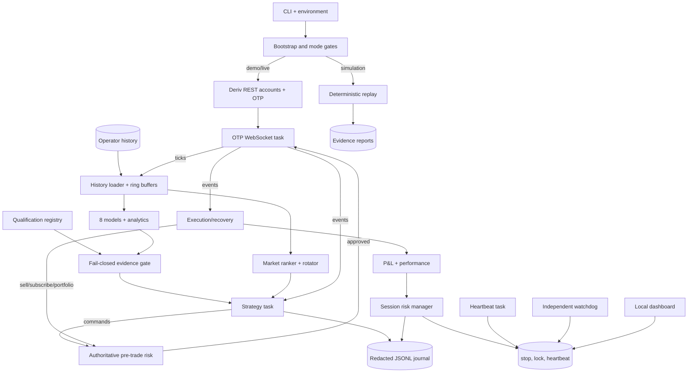
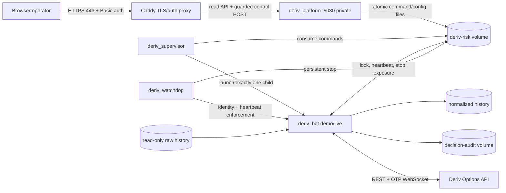
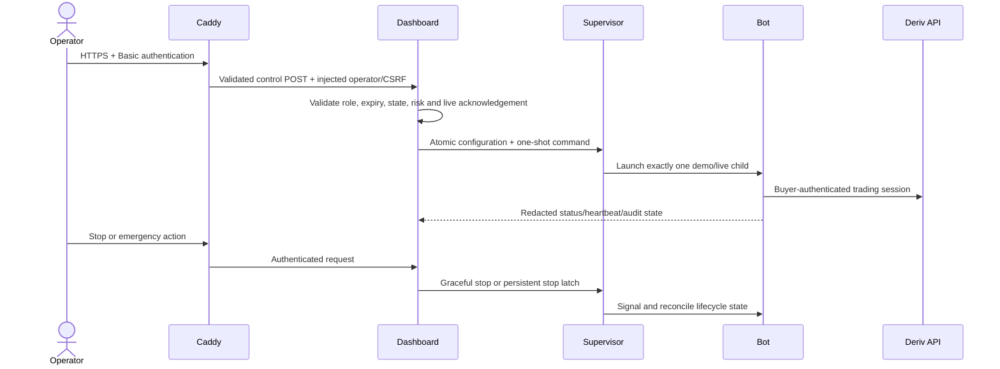
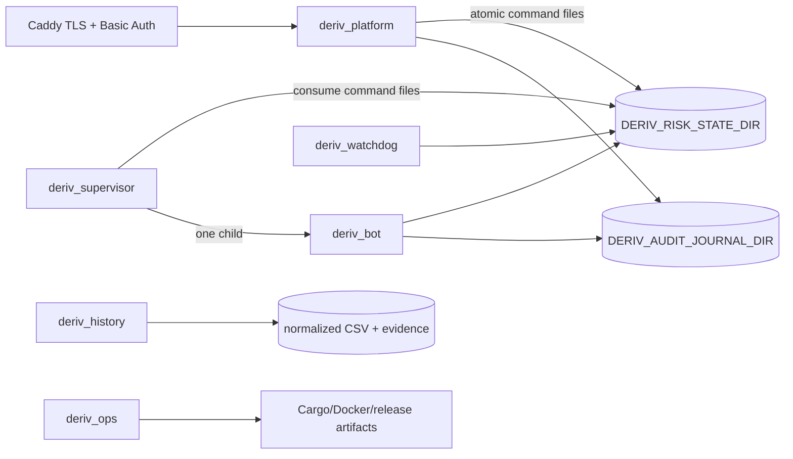

# Deriv Multi-Strategy Trading Platform — Complete Architecture

## 1. Scope and operating modes

This is a Rust/Tokio trading and research platform, not a single trading loop. It combines Deriv connectivity, historical/live market data, eight evidence-gated models, four contract families, deterministic evaluation, authoritative risk, resilient execution, operator controls, audit evidence, hardened deployment, and buyer due diligence.

### Verified implementation footprint

At this revision, all maintained executable implementation is Rust. Documentation, configuration, schemas, evidence, and presentation templates remain in their standard interoperable formats. The platform therefore comfortably exceeds 11,000 lines as a complete repository. Counts describe scope, not profitability or quality; architecture, tests, safety boundaries and reproducibility remain the substantive evidence.

| Mode | Data/execution | Safety boundary |
|---|---|---|
| `simulation` | Historical CSV, virtual clock, seeded RNG; no broker | No credentials or orders |
| `demo` | Demo Options account and OTP WebSocket | Default network mode; explicit risk configuration |
| `live` | Real Options account and OTP WebSocket | Requires `live-trading` feature and `DERIV_ENABLE_LIVE_TRADING=I_UNDERSTAND_REAL_MONEY` |

The dashboard is an authenticated control plane. It can persist bounded risk settings, request demo or explicitly acknowledged live startup through the supervisor, request graceful shutdown, and latch a persistent emergency stop. It never receives broker credentials and never bypasses the runtime risk gate; trading decisions and broker orders remain owned by `deriv_bot`.

### Documented operating history and live evidence

The operator reports six months of Deriv demo-account testing and prior live-account use. These are seller-reported usage-history statements, not independently established duration, profitability, win rate, production readiness, or future-performance claims. Any broker records offered to support them are controlled due-diligence material and should be reviewed independently with credentials and unnecessary personal data redacted.

### Buyer responsibility and allocation of trading risk

The buyer remains solely responsible for deciding whether, where and how to deploy the software; selecting accounts, credentials, capital and risk limits; validating the effective configuration; supervising operation; and complying with applicable law and provider terms. To the maximum extent permitted by governing law and the final signed agreement, the software is supplied as is and as available, without a guarantee of future profit, win rate, availability or trading outcome, and the seller, authors and contributors do not accept responsibility for buyer trading decisions or losses merely because the software was evaluated, licensed, modified, deployed or used. This architecture statement does not itself eliminate legal liability: the final signed agreement must contain the applicable warranties, exclusions, limitation of liability, indemnities, acceptance criteria and dispute terms reviewed for the parties' jurisdictions.

## 2. Whole-system view



## 3. Runtime and concurrency

`deriv_bot` is the main async process. Shared state uses `Arc<RwLock<_>>`; broker commands use bounded MPSC; events and shutdown use broadcast channels. All tasks are owned and joined cooperatively.

| Task | Owns/consumes | Produces |
|---|---|---|
| WebSocket/API | Commands, connection, limiter, heartbeat/staleness | Broadcast broker events |
| Strategy | Events, history, qualification, risk, rotator; lifecycle and pending proposal | Proposal/buy commands; decisions |
| Executor | Events and pending-buy handoff; open/closing/settled maps | Subscribe/sell/portfolio commands |
| Risk monitor | Events plus 1-second timer | Stop evaluation and transport shutdown after drain |
| Heartbeat | 1-second timer | Heartbeat and manual-stop detection |
| Status | 30-second timer | Redacted tick, latency, family and risk summaries |

Main waits for Ctrl+C, optional demo deadline, or automatic stop. It drains tracked exposure up to the timeout, broadcasts shutdown, joins tasks/WebSocket with timeouts, flushes the journal, and logs final risk state.

## 4. Startup and authentication

```mermaid
sequenceDiagram
  actor O as Operator
  participant B as Bootstrap
  participant R as Deriv REST
  participant A as API task
  O->>B: CLI/environment
  B->>B: Load env; expire old raw API records
  B->>B: Validate mode, history, explicit limits
  B->>B: Enforce live compile + acknowledgement gates
  B->>B: Initialize journal, seed, risk lock
  alt simulation
    B->>B: Virtual-time history replay
  else demo/live
    B->>R: Discover Options accounts
    R-->>B: Active accounts and balance
    B->>B: Select demo/real account matching mode
    B->>R: Request account OTP
    R-->>B: WebSocket URL
    B->>B: Verify /ws/demo or /ws/real
    B->>A: Subscribe before history scan; launch
    A-->>B: Connected
    B->>B: Start runtime tasks
  end
```

Credentials remain environment-owned. `DERIV_ACCESS_TOKEN` is preferred; `DERIV_PAT` is a compatibility alias. Logs redact tokens, accounts, proposal/contract IDs, and provider error bodies.

## 5. Broker boundary

`ApiHandle` implements `Broker`. `BrokerCommandSender` is the sole dispatch path and applies authoritative risk before enqueueing.

| Command | Purpose |
|---|---|
| `RequestProposal` | Accumulator proposal: symbol, currency, stake, growth |
| `RequestOverUnder` | Digit Over/Under and barrier |
| `RequestMatchesDiff` | Digit Matches/Differs and barrier |
| `RequestRiseFall` | Direction and minute duration |
| `BuyContract` | Buy exact confirmed proposal/price |
| `SellContract` | Reduce tracked exposure |
| `SubscribeContract` | Track existing exposure |
| `RequestPortfolio` | Reconcile uncertain buy |

Normalized events are `Connected`, `Disconnected`, `Tick`, `Proposal`, `ContractOpened`, `ContractSold`, `ContractUpdate`, `Portfolio`, and structured `Error`. Numeric strings normalize safely; malformed messages fail, malformed portfolio items filter individually, and errors preserve request/sell context.

The adapter rate-limits outbound traffic, sends heartbeats, detects staleness, reconnects, resubscribes ticks, and recursively redacts sensitive JSON keys.

## 6. Market data and selection

`HistoryLoader` accepts compatible per-symbol CSV/history, headers or headerless input, normalizes descending records into chronological order, and holds a bounded `RingBuffer<Tick>` per symbol. Live ticks append to both memory and configured history. `Tick` provides quote, bid/ask, midpoint, spread and last digit.

Default markets: `R_10`, `1HZ10V`, `R_25`, `1HZ25V`, `R_50`, `1HZ50V`, `R_75`, `1HZ75V`, `R_100`, `1HZ100V`.

`IndexRotator` performs configured-order round robin. Historical ranking considers freshness, sample count, recent/baseline RMS, tail rate, spread, chaos edge and theory confidence. A candidate switches only above the quality floor and score margin.

Per-market state records wins/losses, loss streaks, post-win diversification, and 5/10-minute loss cooldowns. Cooling markets are skipped; if all cool, the earliest reopening market is selected for waiting.

## 7. Strategy intelligence

| Model | Interpretation |
|---|---|
| Fluid Dynamics | Price-flow pressure, velocity and dispersion |
| Chaos Theory | Non-linear regime behavior |
| Mean Reversion | Deviation from recent center |
| Trend Analysis | Direction and persistence |
| Multi-Timeframe | Short/long-window agreement |
| Nash Equilibrium | Directional balance |
| Tick Velocity | Speed and acceleration |
| Volume Surge | Abrupt tick-activity proxy |

Supporting analytics: mean/std-dev/EMA/sigmoid, Kalman prediction, Hurst exponent, volatility, digit bias/frequency, least-likely digit, digit velocity, reversal pattern, session quality, payout edge, and calibrated match risk.

### Qualification

`config/strategy-qualifications.json` loads fail-closed. A model gets weight only if all evidence gates pass: completeness/checksum, sample count, drawdown, ruin risk, parameter variants/neighbour stability, market/regime coverage, market dependency, calibration/Brier score, and dataset independence. Unqualified scores get zero weight.

Qualified scores produce consensus, confidence, directional counts and agreement. Normal and relaxed paths have separate thresholds; neutral scores never count as agreement.

### Entry filters

Checks include symbol alignment, history warm-up, availability, spread/velocity, qualification, consensus path, agreement, session quality, reversal context, match risk, payout edge after slippage/fees, decision latency, risk/timed/pacing cooldowns, proposal freshness and authoritative approval.

Cooldown remains analyse-only: ticks persist and signals may be observed, but no proposal is sent. No-entry advances to the next market.

## 8. Contract families

`EnabledContractStrategy`/`ContractTypeRotator` select enabled implementations, cap same-family runs, penalize a losing family temporarily, track results, diversify and abstain while preserving the shared risk gate.

| Family | Entry | Exit/expiry | Special validation |
|---|---|---|---|
| Accumulator | Growth-rate proposal | Profit/stop threshold, first post-entry tick max-hold, timed fallback | Effective edge and risk-owned stake |
| Over/Under | Digit direction/barrier | Provider auto-settlement | Bias, last digit, match risk, latency |
| Matches/Differs | Least-likely digit/match path | Provider auto-settlement | Calibrated match thresholds |
| Rise/Fall | Multi-model direction | Configurable 1–60 minutes | Walk-forward results, minimum samples, target rate, Wilson lower bound |

Failed Rise/Fall validation can fall back to ACCU rather than claim direction. Payout gating uses ask/total payout and positive edge after costs.

## 9. Lifecycle

```mermaid
stateDiagram-v2
  [*] --> Idle
  Idle --> CollectingTicks
  CollectingTicks --> Analysing
  Analysing --> CollectingTicks: reject/abstain/cooldown
  Analysing --> ProposalPending
  ProposalPending --> ProposalReady: correlated proposal
  ProposalPending --> CollectingTicks: error/timeout/disconnect
  ProposalReady --> BuyPending: approved buy
  ProposalReady --> CollectingTicks: stale/rejected
  BuyPending --> ContractOpen: confirmation/recovery
  BuyPending --> BuyPending: disconnected; uncertain
  BuyPending --> CollectingTicks: portfolio proves absent
  ContractOpen --> Settling
  Settling --> CooldownOrReanalyse: unique settlement
  CooldownOrReanalyse --> CollectingTicks
  CollectingTicks --> Stopped
  ContractOpen --> Stopped: reduce-only survives
```



Transitions are explicit and tested; invalid attempts reject and journal. Proposal disconnect aborts. Buy disconnect preserves uncertainty and requests portfolio. Sell disconnect retains exposure. Recovery chooses the latest same-symbol contract purchased no earlier than the entry tick, preventing duplicate buy.

## 10. Execution and recovery

- `open_contracts`: ACCU symbol, cost, entry epoch, held ticks, open time.
- `auto_contracts`: symbol, cost and auto-settling family.
- `closing_contracts`: sell-attempt time and whether retry awaits a real tick.
- `recently_settled`: five-minute duplicate suppression.

ACCU exits on profit, stop, first real post-entry tick, or timed fallback. Lost sells retry every 250 ms. `InvalidtoSell` waits for next tick; late `ContractNotFound` for settled/absent exposure is expected. Reconnect resubscribes tracked contracts.

Settlement derives P&L from confirmed cost/sold value, updates market/family/session risk, removes exposure, checks invariants, rotates and advances lifecycle. Missing sell value is never treated as zero-value loss.

## 11. Authoritative risk

`RiskManager` owns fixed-point policy, P&L, streaks, stake, cooldown and stop reason. `risk_v2` is the mandatory command gate and persistent exposure ledger.

- Money comparisons use integer minor units.
- Stake is bounded by minimum, runtime max, hard cap, balance exposure and signal risk.
- Reviewed network config enforces one open contract.
- No Martingale: losses reduce stake; recovery stays drawdown-scaled.
- Three-win behavior temporarily caps stake for a bounded safe window.
- Balance-derived session-loss stop accounts for earlier profit.
- Session-profit target stops new entries.
- Trailing lock activates after a profit cushion and stops on giveback.
- Loss streaks create exponential cooldown (max one hour), then persistent stop.
- Post-loss pauses, thirty-second cadence and periodic rest limit activity.

Proposal requires fresh data, valid stake, all hard/expected-loss/market/family/exposure budgets, and no loss throttle. Buy also requires exact confirmed ID/price, age ≤3 seconds, cardinality and a second exposure check.

When stopped, new risk fails. Only portfolio inspection and reduce-only subscribe/sell for known exposure survive. Unknown IDs fail.

Kill switches: stale data, ≥20% API error rate after ≥20 events, manual/persisted stop, critical persistence failure, open-cardinality breach and post-trade exposure breach. Shutdown drains exposure or fails closed.

## 12. Persistent controls, watchdog and dashboard

| File | Purpose |
|---|---|
| `runtime.lock` | PID + process start ticks + boot ID; concurrency/PID-reuse protection |
| `runtime-heartbeat` | One-second liveness |
| `emergency.stop` | Operator/watchdog latch |
| `stop-state.json` | Durable reason/state |
| `dashboard-audit.jsonl` | Authenticated control attempts and outcomes |
| `control-status.json` | Supervisor state and update timestamp |
| `configured-stake-minor` | Persisted operator ceiling, validated at $1-$100 |
| `configured-loss-limit-bps` | Persisted session-loss percentage in basis points |
| `control-start-demo` | Atomic demo-start request consumed once by supervisor |
| `control-start-live` | Atomic guarded-live request consumed once by supervisor |
| `control-stop-demo` | Atomic graceful-stop request for the active child |

Critical writes use private Unix modes, create-new temporary files, sync, atomic rename and parent sync.

`deriv_watchdog` validates exact process identity and heartbeat after startup grace. Staleness latches stop, sends TERM, waits two seconds, then KILL only if the same identity remains. `--check` supports health checks.

`deriv_platform` is a bounded HTTP control server: 32 connections, 16 KiB header limit, I/O timeouts, CSP, embedded assets, telemetry parsing and atomic control writes. Read routes include static assets, `GET /api/v1/status`, `/api/v1/telemetry`, `/api/v1/qualifications`, and `/api/v1/control/config`. Authenticated write routes include risk configuration, demo start, guarded live start, graceful stop, and emergency stop.

`deriv_supervisor` is the always-running bot service entrypoint. It consumes one-shot control files, launches exactly one `deriv_bot` child, injects only server-validated stake/loss settings, adds the exact live acknowledgement only for guarded live requests, forwards graceful shutdown, and publishes control state. Demo graceful-stop state can be archived for convenient restart; live stop/failure remains review-locked.

Write controls require distinct 32+ character bearer and CSRF tokens, operator role, and an unexpired Unix deadline. Comparison is constant-time; emergency attempts are rate-limited per peer; actions retain 1-30 days. In the public deployment, Caddy terminates HTTPS, applies Basic authentication and security headers, keeps port 8080 private, and injects operator credentials server-side only for matched control POST routes. Browser users never type or receive those secrets.

## 13. Data, privacy and provenance

| Class | Location | Policy |
|---|---|---|
| History | `HISTORY_PATH` | Research input + normalized live append; transfer rights separate |
| Raw API records | `DERIV_API_RECORDS_DIR` | Capture off by default; 24-hour expiry |
| Decision journal | `DERIV_AUDIT_JOURNAL_DIR` | Append-only redacted JSONL; stable hashed IDs |
| Risk state | `DERIV_RISK_STATE_DIR` | Durable shared safety state |
| Private generated evidence | `reports/private/history` | Ignored audit, checksums, and provenance output; not submitted |

Journal initialization records mode, markets, dataset checksum, seed and context. Events cover transitions, decisions/rejections, execution, recovery, latency, breakers and P&L. Audit scripts check raw-normalized provenance, overlap/duplicates, chronology, quality and manifests.

## 14. Deterministic evaluation

Simulation uses monotonic virtual time and seeded RNG. Backtest replays history without broker and injects missing ticks, disconnects, delayed acknowledgements and pricing-approximation faults.

Metrics include deterministic trace/hash, trades, wins/losses/rate, P&L/return, peak/drawdown, profit factor, Sharpe-like value, tail loss, longest loss run, confidence interval, ruin risk, exposure, injected faults and pricing error. Same input/seed/faults reproduce the trace. These are hypothetical engineering results, not performance promises.

The fixture generator creates deterministic data; `deriv_history` audits provenance and synchronized overlap; the Rust operations CLI, SBOM and notices support verification.

## 15. Deployment



The multi-stage image compiles live support but never selects it automatically. Bot, supervisor and dashboard use read-only roots, tmpfs where needed, dropped capabilities, no-new-privileges, resource limits and log rotation. Watchdog shares the bot PID namespace and only adds `KILL`. Dashboard has no broker credentials and is reachable only through Caddy in the public profile. Risk, audit and Caddy certificate/configuration volumes persist.

The current saved profile is $1 stake and 1% session loss. While idle, the authenticated operator can select $1-$100 for demo or guarded live sessions. Effective stake can still be reduced or rejected by verified-balance sizing, exposure budgets, signal-risk scaling, drawdown logic, one-open-contract enforcement and broker proposal limits. Container uptime does not prove seller-reported operating history; that evidence is reviewed separately.

## 16. Source component ownership map

| Path | Responsibility |
|---|---|
| `src/main.rs` | Bootstrap, orchestration, strategy/executor loops, shutdown, integration tests |
| `src/modules/config.rs` | Safety/strategy/timing/market/family constants |
| `src/modules/runtime.rs` | CLI/env, modes, deadline, risk config |
| `src/modules/api.rs` | REST/OTP/WebSocket, commands/events, reconnect, limiting, redaction |
| `src/modules/models.rs` | Domain types, digit/match logic, family rotator, states |
| `src/modules/math.rs` | Statistics and ring buffer |
| `src/modules/market.rs` | History ingest/append, scoring, rotation, cooldown |
| `src/modules/strategy.rs` | Eight models, consensus, Rise/Fall validation, filters |
| `src/modules/qualification.rs` | Evidence schema/gate |
| `src/modules/execution.rs` | Pacing/cadence |
| `src/modules/risk.rs` | Fixed-point session risk/stake |
| `src/modules/risk_v2.rs` | Command gate, exposure, lock, heartbeat, kill switches |
| `src/modules/interfaces.rs` | Broker/strategy abstractions and guarded sender |
| `src/modules/journal.rs` | Redacted evidence and stable hashes |
| `src/modules/deterministic.rs` | Virtual clock, RNG, simulation |
| `src/modules/backtest.rs` | Replay, faults, metrics/reports |
| `src/modules/retention.rs` | 24-hour record lifecycle |
| `src/modules/schema_contract.rs` | Pinned Deriv schema tests |
| `src/modules/characterization_tests.rs` | Frozen lifecycle/recovery/parser/security behavior |
| `src/modules/reliability_tests.rs` | 10,000-case robustness properties |
| `src/num_serde.rs` | Numeric/string deserialization |
| `src/bin/platform.rs` | Dashboard/stop API |
| `src/bin/watchdog.rs` | Independent liveness/termination |
| `src/bin/generate_synthetic_fixture.rs` | Synthetic fixture |
| `web/*` | Dashboard UI |
| `config/*` | Qualifications/evidence key |
| `schemas/deriv/*` | Pinned provider contract |
| `scripts/*` | Provenance/history/build tooling |
| `reports/private/history/*` | Ignored private generated dataset evidence; not submitted |
| `data-room/*` | Buyer architecture/threat/capability/evidence package |

Module files are currently `include!`d into one crate scope; `src/modules.rs` records the conceptual module set.

### Crate assembly caveat

`src/modules.rs` is not the active crate root and does not enumerate every implementation file. `src/main.rs` is the executable crate root and textually includes the files under `src/modules/`; consequently their non-`pub` items share one crate scope. `src/num_serde.rs` is a conventional child module, while `src/modules/characterization_tests.rs` and `src/modules/reliability_tests.rs` compile only in test builds. This matters during extraction: moving an included file behind a normal Rust module boundary changes visibility and name resolution.

## 17. Configuration and control plane

Configuration has four layers. Compile-time policy in `src/modules/config.rs` defines reviewed absolute ceilings and strategy constants. Runtime environment/CLI values select the mode, markets, storage and limits. The authenticated dashboard persists an idle-session risk profile and emits one-shot lifecycle commands. Docker Compose connects the private services, persistent volumes and public TLS proxy. Values accepted by later layers remain bounded by the compiled ceilings and runtime validation.

| Input | Consumer | Contract |
|---|---|---|
| `--mode`, `DERIV_MODE` | bootstrap | `demo`, `live`, or `simulation`; CLI wins |
| `--symbols`/`--symbol`, `DERIV_SYMBOLS` | market/runtime | Comma-separated symbols; empty resolves to the ten compiled defaults |
| `--history`, `HISTORY_PATH` | history/simulation/journal | Must be explicit and non-empty; CLI wins |
| `DERIV_APP_ID` | REST account discovery | Required only for network modes |
| `DERIV_ACCESS_TOKEN` | REST authentication | Preferred bearer; `DERIV_PAT` then `DERIV_PAT_TOKEN` are warned compatibility fallbacks |
| `DERIV_ENABLE_LIVE_TRADING` | live bootstrap | Must exactly equal `I_UNDERSTAND_REAL_MONEY`, in addition to the Cargo feature |
| `DEMO_DURATION_SECS` | demo supervisor | Missing or `0` means continuous; positive integer adds an automatic deadline |
| `DERIV_RANDOM_SEED` | journal/simulation | Defaults to a fixed seed; makes replay decisions reproducible |
| `DERIV_RISE_FALL_DURATION_MINUTES` | Rise/Fall | Validated to the reviewed 1-60 minute range |
| `DERIV_MAX_STAKE_MINOR` | runtime risk | Explicit in network modes; USD deployments accept 100-10,000 minor units (USD 1-100), still subject to effective-stake reductions and rejection |
| `DERIV_SESSION_LOSS_LIMIT_BPS` | runtime risk | Positive and no looser than the compiled session ceiling |
| `DERIV_MAX_OPEN_EXPOSURE_BPS` | runtime risk | Positive and no looser than the compiled balance-exposure ceiling |
| `DERIV_MAX_OPEN_CONTRACTS` | runtime risk | Must equal one in the reviewed network configuration |
| `DERIV_MAX_CONSECUTIVE_LOSSES` | runtime risk | Explicit, accepted range 1-10 |
| `DERIV_LOSS_COOLDOWN_BASE_SECS` | runtime risk | Explicit, accepted range 10-3,600 seconds |
| `DERIV_API_RECORDS_DIR` | retention | Raw/ephemeral records; expired after 24 hours |
| `DERIV_AUDIT_JOURNAL_DIR` | journal | Normalized append-only decision evidence |
| `DERIV_RISK_STATE_DIR` | bot/platform/watchdog | Shared stop, heartbeat and identity directory |
| `DERIV_DASHBOARD_*` | platform | Bind, bearer, CSRF, expiry and audit-retention controls |
| `DERIV_WATCHDOG_*` | watchdog | Stale threshold and startup grace |
| `SIM_*` | backtester | Pricing, latency, TTL, rate-limit and deterministic fault injection; code also accepts accumulator growth, contract-duration ticks and sell-bid discount, while `SIM_EXPECT_REPLAY_HASH` enforces the final trace hash |
| `RUST_LOG` | all Rust binaries | Log verbosity; sensitive payloads remain subject to redaction |

`.env.example` is the demo template, not a secret store and not proof of the effective deployment configuration. `.env` is deliberately ignored. Credentials never belong in source, images, evidence manifests, backups or buyer bundles.


### Dashboard control contract

| Route | Purpose and enforced conditions |
|---|---|
| `GET /api/v1/status` | Redacted process, mode, heartbeat, stop and control-state snapshot |
| `GET /api/v1/telemetry` | Redacted operational telemetry; no broker credential or raw token exposure |
| `GET /api/v1/qualifications` | Reviewed strategy qualification evidence |
| `GET /api/v1/control/config` | Saved stake/loss profile and lifecycle availability |
| `POST /api/v1/control/configure-risk` | Idle only; validates USD 1-100 stake and 0.01%-20% session-loss selection before atomic persistence |
| `POST /api/v1/control/start-demo` | Starts one supervised demo child using the saved validated profile |
| `POST /api/v1/control/start-live` | Requires idle state, saved risk, risk acknowledgement, typed `LIVE`, no stop latch, live-enabled build and exact runtime acknowledgement |
| `POST /api/v1/control/stop-trading` | Requests graceful shutdown; live stop remains review-locked until reconciliation |
| `POST /api/v1/emergency-stop` | Writes the persistent stop latch and terminates the supervised child; rate-limited and audited |

Every write also requires Caddy authentication plus injected, short-lived operator and CSRF credentials. The browser never receives those backend credentials. Only the bot process receives buyer-owned Deriv credentials; the dashboard and Caddy do not.



## 18. Repository and directory inventory

The following inventory distinguishes maintained source from local/generated state. A folder can exist locally while being intentionally absent from Git and from a buyer delivery.

| Path | Class | Contents and architectural treatment |
|---|---|---|
| `.github/workflows/` | Maintained CI | Least-privilege GitHub Actions workflow for format, strict Clippy, locked all-target tests, dependency audit and BuildKit image build |
| `.git/` | VCS metadata | Repository history and object database; not runtime input and excluded from images/packages |
| `.risk/` | Local runtime state | Heartbeat, stop snapshots and runtime identity artifacts; sensitive operational state, ignored and never treated as source |
| `backups/` | Local recovery/quarantine | Source archives, manifests and quarantined/stale material; excluded from Docker and buyer packages. Quarantined archives may contain secrets and must not be committed or transferred without a dedicated security review |
| `buyer-data-room/` | Generated delivery output | Packaged archive and checksum created by `deriv_ops package-data-room`; reproducible output, not authoritative source |
| `config/` | Maintained policy/evidence | Fail-closed strategy qualification registry and Ed25519 evidence-verification public key |
| `data/api-records/` | Ephemeral local data | API-derived capture subject to 24-hour retention; not an audit-journal destination and never packaged |
| `data/audit/` | Local audit data | Redacted decision JSONL produced by the runtime; ignored, environment-specific and not source |
| `data/normalized/`, `data/history/`, `data/provenance/private/` | Optional local data | Derived/history/private provenance locations reserved by ignore policy; transfer rights and retention are external concerns |
| `data-room/` | Maintained due diligence | Architecture, capabilities, provenance, threat model, evidence manifest, roadmap/SLA, index, evaluator and guarded packaging script |
| `fixtures/synthetic/` | Maintained deterministic fixture | Synthetic `R_100` CSV fixture plus SHA-256 sidecar used to verify generator and replay; intentionally allow-listed despite the general CSV ignore rule |
| `history-normalized/` | Local derived dataset | Writable normalized per-symbol CSV history used by Compose; large, ignored, non-transferable by default and distinct from raw read-only history |
| Transaction documents | Handled separately during due diligence; historical drafts are not part of the current submission |
| `reports/private/history/` | Ignored private output | Generated dataset audit and provenance output; not part of source submission |
| `reports/private/` | Optional private output | Local reports/scanner results; ignored and excluded from delivery |
| `schemas/deriv/` | Maintained integration contract | Pinned local contract-family metadata used by schema tests; not a live provider-schema fetch |
| `scripts/` | Maintained engineering tools | History audit, overlap analysis and native Rust operations CLI |
| `src/` | Maintained Rust source | Main runtime, numeric serde helper, conceptual module declaration, implementation includes and binary entry points |
| `target/` | Generated build output | Cargo artifacts; ignored and excluded from Docker context/delivery source |
| `web/` | Maintained embedded UI | HTML/CSS templates compiled into `deriv_platform` and rendered by Rust; no JavaScript or separate web build pipeline |

### Root-level files

| Path | Responsibility |
|---|---|
| `Cargo.toml`, `Cargo.lock` | Rust package, seven explicit binaries, feature gate, dependencies and locked resolution |
| `Dockerfile`, `docker-compose.yml`, `.dockerignore` | Multi-stage live-capable image; Caddy, private dashboard, supervised bot and watchdog topology; persistent risk/audit/TLS volumes; build-context exclusions |
| `.env.example`, `.gitignore` | Safe configuration template and local/secret/generated-state exclusion policy |
| `README.md` | Product/operator overview, configuration, commands and project map |
| `BACKTESTING.md` | Simulation semantics, fault controls, metrics and qualification boundary |
| `PRODUCT_API.md` | Dashboard trust boundary, authentication and endpoint contract |
| `BUYER_ONBOARDING.md` | Buyer credential ownership, environment separation and handover |
| `SECURITY_EVIDENCE.md` | Verified checks, open checks and release gates |
| `CLAIMS.md` | Allowed, limited, planned and prohibited product claims |
| `AUDIT.md` | Data/API/IP/transfer engineering audit and closing actions |
| `AUTHORSHIP_DECLARATION.md`, `COPYRIGHT`, `SUBMISSION_SCOPE.md` | Authorship draft, copyright notice, and non-contractual appraisal scope; transaction rights are handled separately |
| `THIRD_PARTY_LICENSES.md`, `THIRD_PARTY_LICENSES.tsv` | Human- and machine-readable dependency notices |
| `deriv_bot.cdx.json` | CycloneDX software bill of materials |

### Tooling and delivery flow

`generate_synthetic_fixture` deterministically creates the test CSV. `deriv_history audit` validates chronology, quality, hashes and provenance; `deriv_history overlap` measures cross-symbol timestamp overlap. `deriv_ops reproducible-build` builds twice in isolated target directories and compares binaries. `deriv_ops buyer-evaluate` formats/tests, regenerates and compares the fixture, checks its checksum, reproduces the pinned simulation hash, compile-checks the live feature without enabling live execution, optionally audits dependencies, and verifies reproducible builds.

`deriv_ops package-data-room` is a guarded release assembler. It requires a separately supplied final transaction document whose review status is explicitly confirmed by the operator, rejects draft or superseded documents, stages an allow-listed source/evidence/legal/scripts set, creates a complete SHA-256 manifest, and emits a compressed archive plus checksum under `buyer-data-room/`. It deliberately excludes credentials, `.env`, local history, runtime state, raw API records, audit logs, backups, private reports, Git metadata and build output. Media placeholders remain explicit until buyer-verifiable recordings are supplied.

## 19. Verification and failure policy

Tests cover math, sizing/caps, loss/profit/streak stops, every lifecycle transition, correlation/parsing, duplicate/out-of-order events, disconnect/recovery paths, sell context, market ranking/rotation, every family shape, qualification, redaction, retention, dashboard security, watchdog identity, pinned schemas, deterministic replay and 10,000-case reliability scenarios.

CI runs least-privilege checkout, formatting, strict Clippy, locked all-target tests, dependency audit with warnings denied, and BuildKit container build.

The platform fails closed on missing live acknowledgement/config/risk state, stale data, unconfirmed/expired/mismatched proposal, unknown exposure, high error rate, persistence failure, invalid transition, unqualified evidence or invariant failure. After stop, only inspection and known-exposure reduction survive.

## 20. Explicit limitations

- Six months of demo testing and prior live-account use are seller-reported. The repository does not independently establish duration, profitability, production readiness, or future results; supporting broker evidence must be reviewed separately.
- Default evidence may intentionally leave models unqualified.
- Replay uses historical/synthetic input and approximate pricing.
- Provider availability, schema and contract availability remain external dependencies.
- Dashboard has no native TLS.
- Strong watchdog guarantees depend on Linux `/proc`, Unix signals/permissions/namespaces.
- Data rights/redistribution remain operator responsibilities.
- Risk controls cannot guarantee fills, connectivity, capital preservation or prevent total loss.

This describes the maintained implementation and every repository directory class present at this repository revision. Local ignored contents are described by role, not treated as deliverable evidence. Validated environment values can be stricter; `config.rs`, `.env.example`, CLI arguments and the effective container environment remain authoritative for each run.

## 21. Current implementation reconciliation

This section reconciles the architecture with the Rust-only executable layout introduced by the current revision.

### Binary/process boundaries



`deriv_supervisor` is the container PID 1 for the bot service. It atomically publishes `control-status.json`, remembers requested continuous demo mode, consumes one-shot demo/live/stop files, starts no more than one child, injects only saved stake/loss values, forwards termination, and archives a demo graceful-stop latch. It locates `deriv_bot` through `PATH`; local supervisor use must therefore place `target/release` on `PATH` or install the binaries together.

`deriv_platform` embeds the HTML/CSS templates at compile time and renders current status in Rust. There is no browser JavaScript. JSON APIs remain available for automation. The Rust HTTP server is deliberately small: bounded concurrent connections, 16 KiB header cap, read/write timeouts, no-store responses, CSP, frame denial, MIME sniffing denial, referrer/permissions policy, peer-scoped emergency rate limiting, constant-time secret comparison, atomic state writes, and retained action audit.

`deriv_history` replaces the former Python audit programs. `audit` verifies the exact ten-symbol CSV set, validates timestamp/epoch/finite price fields, detects units/order/duplicates/gaps, preserves price text, writes mode-0600 ascending normalized copies, hashes raw and normalized files, and emits audit/provenance JSON. `overlap` calculates exact timestamp intersections for all ten markets and the two five-market families, adds qualification restrictions, and produces Markdown evidence.

`deriv_ops` replaces shell automation. `release-readiness` validates assets, secret exclusions, formatting, compilation, strict Clippy, all tests, live-feature compilation, deterministic fixture equality/checksum, and Compose configuration. `reproducible-build` performs two isolated release builds and byte-compares `deriv_platform`. `buyer-evaluate` executes the packaged-source engineering evaluation. `package-data-room` enforces a separately supplied reviewed licence and builds an allow-listed archive.

### Compose trust and persistence topology

| Service | Identity and responsibility | Persistent/read-only state |
|---|---|---|
| `bot` | `deriv_supervisor`, spawning `deriv_bot` | Read/write `deriv-risk`, `deriv-audit`, normalized history bind; read-only root FS |
| `watchdog` | Independent heartbeat/process enforcement with shared PID namespace | Read/write `deriv-risk`; `KILL` capability only |
| `dashboard` | `deriv_platform` on internal port 8080 | Read/write risk control state; read-only audit journal |
| `caddy` | Public TLS, Basic Auth, operator/viewer authorization | Caddy certificate/config volumes; no trading credentials |

Caddy exposes ports 80/443 and the dashboard is only `expose`d internally. The configured public address and ACME behavior in `Caddyfile` are deployment-specific and must be changed before deployment to another host. Caddy maps `Denu` to operator controls and `Buyer` to read-only access. `.dashboard.env` supplies password hashes and upstream operator/CSRF values; its operator values must exactly match `DERIV_DASHBOARD_TOKEN` and `DERIV_DASHBOARD_CSRF_TOKEN` supplied to the dashboard service. All secret files are ignored.

### Exhaustive configuration groups

Runtime bootstrap: `DERIV_MODE`, `DERIV_SYMBOLS`, `HISTORY_PATH`, `DERIV_APP_ID`, `DERIV_ACCESS_TOKEN`, legacy `DERIV_PAT`/`DERIV_PAT_TOKEN`, `DERIV_RANDOM_SEED`, `DEMO_DURATION_SECS`, `DERIV_ENABLE_LIVE_TRADING`.

Strategy/runtime policy: `DERIV_RISE_FALL_DURATION_MINUTES`, `DERIV_ADVANCED_FAMILIES_ACTIVATION_DELAY_SECS` and legacy `DERIV_RISE_FALL_ACTIVATION_DELAY_SECS`, `STRATEGY_QUALIFICATIONS_PATH`.

Mandatory network risk: `DERIV_MAX_STAKE_MINOR`, `DERIV_SESSION_LOSS_LIMIT_BPS`, `DERIV_MAX_OPEN_EXPOSURE_BPS`, `DERIV_MAX_OPEN_CONTRACTS=1`, `DERIV_MAX_CONSECUTIVE_LOSSES`, `DERIV_LOSS_COOLDOWN_BASE_SECS`.

Storage/control: `DERIV_RISK_STATE_DIR`, `DERIV_AUDIT_JOURNAL_DIR`, `DERIV_API_RECORDS_DIR`, `DERIV_DASHBOARD_BIND`, `DERIV_DASHBOARD_TOKEN`, `DERIV_DASHBOARD_CSRF_TOKEN`, `DERIV_DASHBOARD_TOKEN_EXPIRES_UNIX`, `DERIV_DASHBOARD_AUDIT_RETENTION_SECS`, `DERIV_WATCHDOG_STALE_SECS`, `DERIV_WATCHDOG_STARTUP_GRACE_SECS`, `RUST_LOG`.

Simulation: `SIM_PROPOSAL_TTL_MS`, `SIM_LATENCY_MS`, `SIM_STALE_QUOTE_MS`, `SIM_PAYOUT_BPS`, `SIM_FEE_BPS`, `SIM_SLIPPAGE_BPS`, `SIM_RATE_LIMIT_PER_SEC`, `SIM_DISCONNECT_PPM`, `SIM_REJECT_PPM`, `SIM_LOST_BUY_RESPONSE_PPM`, `SIM_SELL_FAILURE_PPM`, `SIM_MISSING_TICK_PPM`, `SIM_OUT_OF_ORDER_PPM`, `SIM_MAX_SELL_RETRIES`, `SIM_ACCU_GROWTH_BPS`, `SIM_CONTRACT_DURATION_TICKS`, `SIM_SELL_BID_DISCOUNT_BPS`, `SIM_EXPECT_REPLAY_HASH`.

Packaging: `FINAL_BUYER_LICENCE`, `FINAL_BUYER_LICENCE_REVIEWED=YES`.

### Control-plane failure semantics

- Missing, short, equal, or expired dashboard secrets reject every write.
- Viewer requests are read-only at Caddy; the Rust server independently requires operator headers.
- Risk configuration is rejected while heartbeat is fresh.
- Demo/live start is rejected while an emergency or stop-state latch exists.
- Live start additionally requires idle state, saved stake/loss files, explicit warning acknowledgement, and exact typed confirmation.
- The runtime independently requires the live Cargo feature and exact environment acknowledgement; a control-file request cannot bypass bootstrap gates.
- Emergency stop is durable. The bot heartbeat/runtime safety tasks observe persistent stop state; operators must verify broker exposure and state before restart.
- Dashboard telemetry is derived from redacted journal records and is evidence, not a profitability promise.
